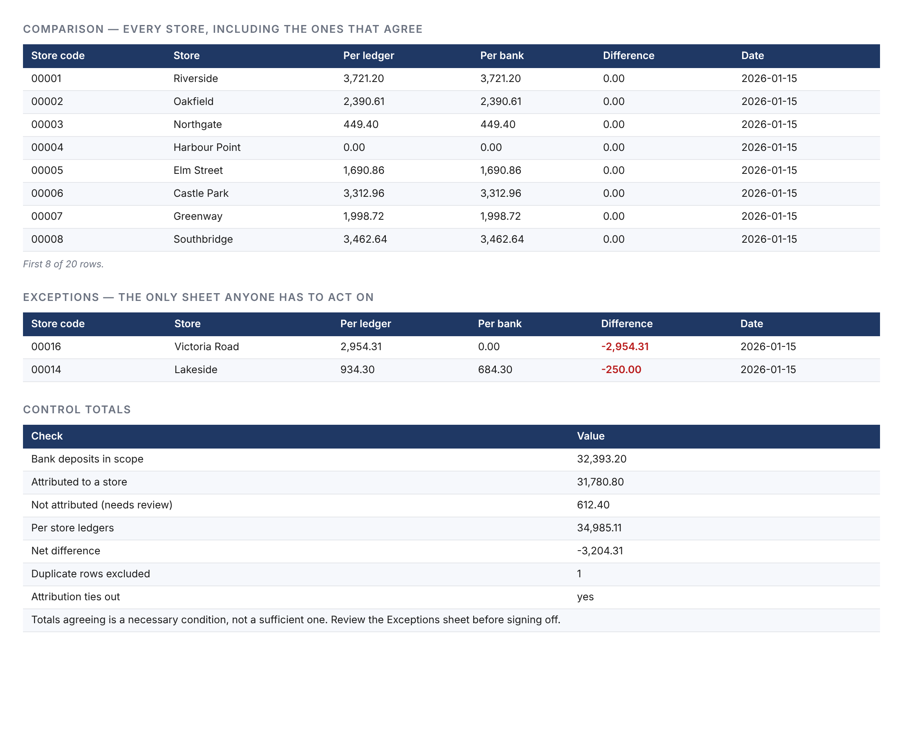

# Store Cash Deposit Reconciliation

Reconciles what retail stores say they banked against what the bank statements
actually show, and produces a review-ready Excel workbook.

Built during a finance internship at a multi-store optical retail chain, where
the daily reconciliation of store cash deposits was done by hand: one person
reading bank exports line by line against a store cash ledger, every working
day. This is a generalised, open version of that tool. No employer data, file
formats, figures or internal documents are included — the repository runs on
synthetic data generated by the script in it.



## The problem

Stores take cash, deposit it at a bank or a cash machine, and record what they
deposited. The bank independently reports what it received. The two should
agree. They usually do. The work is finding the few that don't, without being
fooled by the many ways the data lies to you:

- **Store codes lose their leading zero.** `00003` arrives as `3`. Treating
  codes as numbers anywhere in the chain destroys them silently.
- **Deposit slips carry a person's name instead of a store code.** Whoever
  walked to the bank is on the slip; the store is not.
- **The same movement appears twice** because a bank re-exported an overlapping
  date range. Summing it invents money.
- **The same store deposits at two different banks on the same day.** Not
  summing *that* invents a shortfall.
- **Amounts arrive as text** — `1.234,56`, `1,234.56`, `1234,56` — depending on
  the locale of whoever pressed export.
- **Fees, transfers and card settlements** sit in the same file as the deposits
  and must not be counted.

Each of these produces a confident, wrong number rather than an error.

## How it works

```
cash_ledger.csv  ──┐
store_master.csv ──┼──►  matching cascade  ──►  duplicate detection  ──►  Excel
bank files *.csv ──┘
```

**Matching cascade.** For each bank row, in order: store name found in the
description → clean store code → staff member's name resolved to their store →
a code embedded in free text. Name is deliberately tried *before* code, because
a truncated code is more common than a wrong name — and matching on a broken
code is the failure that produces a silent wrong answer rather than a visible
one.

**Duplicate detection.** Identical `(store, amount, date)` within the *same*
bank is one movement exported twice; the repeat is excluded. The same tuple
across *different* banks is two real deposits and is summed. Source bank is
taken from the filename, so `NORTHBANK_part1.csv` and `NORTHBANK_part2.csv` are
understood as one bank.

**Nothing is guessed.** A deposit that cannot be attributed stays in the output
with its amount, highlighted, flagged for a human. An unattributed amount that
happens to equal some store's shortfall is a coincidence until someone confirms
it, not a match.

**The spreadsheet is an output, not a calculation engine.** Matching, grouping
and summing happen in Python. Excel receives values and single-cell references.
No live array formulas, so sorting a column on someone else's machine cannot
change the answer.

## Output

Four sheets:

| Sheet | Contents |
|---|---|
| `Comparison` | Every store — ledger vs bank vs difference. Stores that agree stay in; a reconciliation that only lists problems can't be checked. |
| `Bank deposits` | Every deposit row in scope, with how it was matched. Unattributed and duplicate rows highlighted. |
| `Exceptions` | Only the stores with a difference, largest first. The sheet someone actually works from. |
| `Checks` | Control totals: deposits in scope, attributed, unattributed, duplicates excluded, whether attribution ties out. |

## Running it

```bash
pip install -r requirements.txt
python generate_sample_data.py          # writes synthetic inputs to sample_data/
python main.py --data sample_data --out reconciliation.xlsx
```

```
Bank files read         : 3
Deposit rows in scope   : 19
Duplicates excluded     : 1
Unattributed deposits   : 1  (612.40)
Stores compared         : 20
Stores with a difference: 2
Attribution ties out    : yes
```

The sample data deliberately contains every failure mode listed above, so the
run above exercises all of them.

## Input format

`cash_ledger.csv` — one row per store per day. `deposited_to_bank` is negative
(money leaving the till).

```csv
store_code,store_name,deposited_to_bank,date
00003,Northgate,-449.40,2026-01-15
```

`store_master.csv` — the authoritative list of store codes and names.

`staff_roster.csv` *(optional)* — links a person to the store they work at, so
a slip carrying only a name can still be attributed.

Any other `*.csv` in the folder is treated as a bank statement:

```csv
reference,description,amount,value_date
00003,CASH DEPOSIT Northgate,"449,40",2026-01-15
```

## Tests

```bash
pytest
```

22 tests. Each one exists because the naive version of the code got that case
wrong: the leading zero, the name-beats-code precedence, the within-bank
duplicate, the across-bank split, the locale-dependent decimal separator.

## A note on verification

The `Checks` sheet reports whether attribution ties out. That is a *necessary*
condition, not a sufficient one — a reconciliation can tie to the penny and
still have two errors cancelling each other out. Totals agreeing is a reason to
keep looking, not a reason to stop. The tool surfaces exceptions; a person
still signs off on them.

## Licence

MIT
